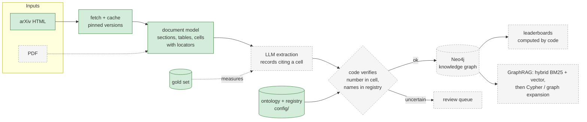

# sota-graph

**Who beats whom, on which benchmark, by how much, with a source for every number.**

[](https://github.com/Ilyas-Khiat/sota-graph/actions/workflows/ci.yml)


sota-graph turns research papers into a trustworthy, queryable knowledge graph
of the state of the art: leaderboards, method lineage, and what changed this
week. Every number in it points back to the exact table cell it was read from,
and nothing is compared unless it was measured the same way.

> **Status: work in progress.** The foundations are done and tested: config-driven
> ontology and registry, arXiv ingestion and table parsing, and a gold set with
> self-checking specs. LLM extraction, the Neo4j graph, leaderboards and GraphRAG
> querying come next (see the [roadmap](#roadmap)).

## Why

Leaderboards built by copying numbers between papers fail quietly. Ten
knowledge-graph-completion papers were enough to find all of these:

- **The same result, two values.** NBFNet reports RotatE's FB15k-237 Hits@10 as
  `0.553`; RotatE's own paper says `.533`. AdaProp reports ConvE's YAGO3-10 MRR as
  `0.520`; ConvE's paper says `.44`.
- **Different protocols side by side.** A\*Net prints a *tail-prediction-only*
  table next to its main one: NBFNet scores `0.509` MRR there and `0.415` under
  the standard protocol. ComplEx reports *filtered* and *raw* MRR in adjacent
  columns. ULTRA mixes *zero-shot* and *fine-tuned* numbers in one table.
- **Settings that are never stated.** ULTRA ranks against the full entity set
  but never says whether the ranking is filtered or raw.
- **Typos.** TuckER prints HypER's WN18 Hits@10 as `958`.
- **Silent mixes.** GraIL is scored with 50 negatives inside a table of
  full-ranking results; MINERVA's tail-only numbers sit unmarked among
  head-and-tail ones.

A copied number with no setting attached is a guess. This project refuses to
guess: what it cannot verify goes to a review queue.

## Principles

- **The LLM extracts facts; code computes comparisons.** The model never decides
  that A beats B.
- **Every number and edge links to its source:** `2106.06935v4#S4.T3/r13/c3` is
  one cell of one table of one pinned arXiv version.
- **Comparable means same dataset, split, metric and settings.** Settings such as
  the ranking protocol are required, or take an explicit default.
- **The ontology is a config file, not code.**
- **Reliability is measured on a hand-checked gold set** and tracked across changes.

## What works today

### A registry that resolves names exactly, or not at all

Datasets, metrics and comparability settings live in [`config/`](config). Mentions
are matched exactly after a small, configured normalization (case, whitespace,
the dash look-alikes PDFs produce). There is no fuzzy matching: a miss is
"unknown", never a guess.

```console
$ sota resolve dataset "FB15k–237"          # en dash
fb15k-237	FB15k-237
$ sota resolve metric "Hits at 10"
hits@10	Hits@10
$ sota resolve dataset "FB15k-237 (filtered)"
unknown	key "fb15k237(filtered)" matches no entry (would go to review)
```

### arXiv ingestion and table parsing

`sota fetch` downloads the HTML that arxiv.org renders for each paper, pinned to a
version, 15 s apart as arXiv's robots.txt asks, and caches it forever (a version
never changes). The parser handles both table markups LaTeXML produces, row and
column spans, several tables per figure each with its own caption, multi-line
cells, math, and citation markers.

```console
$ sota fetch --list papers/kgc.txt
papers  listed 10 | html 10 | no html 0 | failed 0
tables  table figures 95 | tables parsed 109 | figures without a table 0 | tables with holes 0 | tables with conversion errors 0

$ sota tables 1902.10197v1 --table S4.T5
## Table 5 (S4.T5) https://arxiv.org/html/1902.10197v1#S4.T5
|  | **FB15k-237** |  |  |  |  | **WN18RR** |  |  |  |  |
| --- | --- | --- | --- | --- | --- | --- | --- | --- | --- | --- |
|  | MR | MRR | H@1 | H@3 | H@10 | MR | MRR | H@1 | H@3 | H@10 |
| ConvE | 244 | .325 | .237 | .356 | .501 | 4187 | .43 | .40 | .44 | .52 |
| RotatE | **177** | **.338** | **.241** | **.375** | **.533** | 3340 | **.476** | **.428** | **.492** | **.571** |
```

### A gold set that checks itself against the papers

[`gold/kgc`](gold/kgc): 10 papers, 16 tables, **937 results**, 23 cells deliberately
held back for review. A gold spec does not list numbers; it maps a table's rows
and columns to meanings, and the numbers are read out of the paper. While
reading, the paper itself is checked against the spec: every row label must
read the declared method, every column header must name the declared dataset
and metric, and no header may contradict a declared setting. A mapping mistake
fails loudly:

```console
$ sota gold expand --paper 1902.10197v1      # column 2 wrongly declared as Hits@1
1902.10197v1     FAILED
  - table S4.T5: col 2: header ["FB15k-237", "MRR"] does not name metric hits@1
```

Each result carries its full comparability key, including settings the paper
leaves at the field's default:

```console
$ sota gold show 2206.04798v5
## Table 2 (S4.SS2.tab1.t2) https://arxiv.org/html/2206.04798v5#S4.SS2.tab1
split test | protocol=filtered, queries=tail | evidence: Caption: 'Tail prediction performance'; ...

| row label (as printed) | means | fb15k-237 mrr | fb15k-237 hits@1 | ...
| NBFNet | nbfnet (baseline) | 0.509 | 0.411 | ...
| A*Net | astarnet (proposed) | 0.505 | 0.410 | ...
```

Committed snapshots let CI verify the gold set without the papers; locally,
`sota gold check` re-reads every number from the cached pages. See
[gold/README.md](gold/README.md) for the format.

## Architecture



Green is built and tested; dashed is planned.

- **Rust workspace:** `sota-core` (pure domain logic: ontology, registry, document
  model, values, gold), `sota-ingest` (fetching, caching, parsing), `sota-cli`
  (the `sota` command).
- **Two input channels, one document model.** HTML tables are parsed by code;
  PDF tables will be read by a model and every number checked against the
  page's text layer. Papers available in both let the HTML channel measure the
  PDF channel.
- **Model access behind interfaces** (`LlmClient`, `Embedder`) with replay
  backends, so tests never call the network.
- **Query path (planned):** exact alias lookup, then hybrid BM25 + vector
  retrieval fused with reciprocal rank fusion, then Cypher templates or graph
  expansion; answers are built only from verified results.

## Quick start

Requires Rust (the toolchain is pinned in `rust-toolchain.toml`).

```bash
cargo test --all                                   # offline: no network, no paper cache
cargo run -p sota-cli -- check-config              # validate ontology + registry
cargo run -p sota-cli -- fetch --list papers/kgc.txt   # ~2.5 min the first time, then cached
cargo run -p sota-cli -- tables 2106.06935v4 --table S4.T3
cargo run -p sota-cli -- gold check                # re-read all 937 gold results from the papers
cargo test --all -- --include-ignored              # also the tests that need the paper cache
```

## Repository layout

```
config/          ontology.toml, normalization.toml, registry/<topic>.toml
papers/          pinned arXiv ids per topic
gold/            gold specs (<topic>/<paper>.toml) and their result snapshots
crates/
  sota-core/     ontology, registry, document model, values, gold (no I/O)
  sota-ingest/   arXiv HTML fetcher, cache, LaTeXML parser
  sota-cli/      the `sota` command
```

## Roadmap

- [x] Workspace, CI (fmt, clippy, tests)
- [x] Ontology and registry as config, exact alias resolution
- [x] arXiv HTML channel: polite fetching, caching, table parsing
- [x] Gold set for KG completion with self-checking specs
- [ ] LLM extraction with cell citations, verification and a review queue
- [ ] Neo4j writer, comparison engine, `sota leaderboard`
- [ ] `sota eval`: extraction quality on the gold set, tracked over time
- [ ] PDF channel, measured against the HTML channel
- [ ] Hybrid retrieval + GraphRAG `sota ask`, with a retrieval ablation
- [ ] Second topic: multi-hop QA and GraphRAG benchmarks

## Data

Only public papers are used. Downloaded pages stay in a local, git-ignored
cache and are never redistributed; the repository holds arXiv ids, table
locators and the numbers themselves. Test fixtures are hand-written HTML that
reproduces the converter's structure, not any paper's content.

## License

[MIT](LICENSE)
